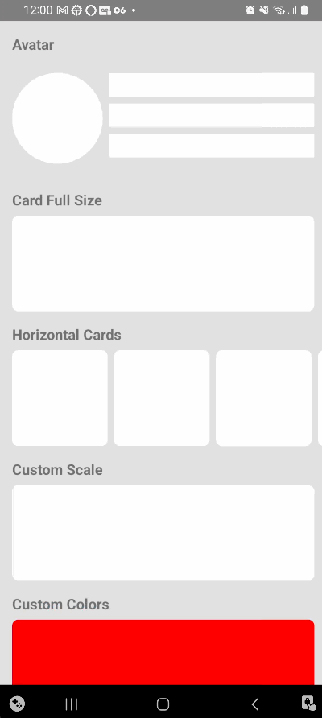
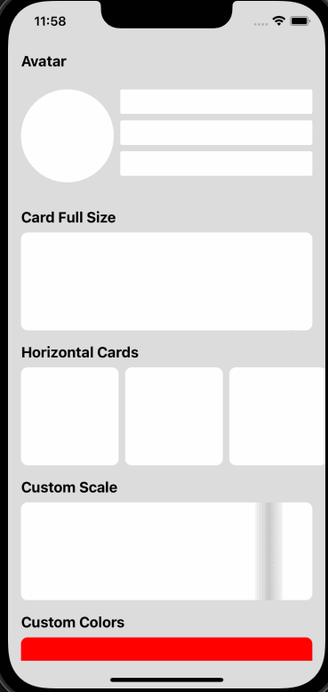
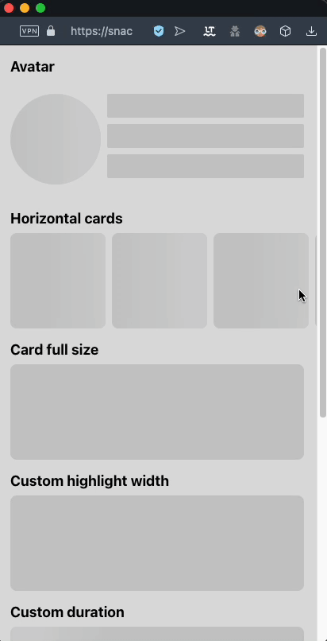

<p align="center">
  
  <br>
  <sub>A pure JavaScript, performant, typed shimmer component for Android, iOS, and Web.</sub>
</p>

<p align="center">
  <b>React Native Gradient Shimmer</b> delivers buttery smooth 60 FPS skeleton loading screens across Android, iOS, and Web. Powered by React Native's native Animated driver and flexible linear gradient engines (<code>expo-linear-gradient</code> or <code>react-native-linear-gradient</code>), it brings zero native dependencies, declarative layout tree composition via <code>ShimmerLayout</code>, and perfectly synchronized animations with zero configuration drift.
</p>

<p align="center">
  <a href="LICENSE"></a>
  <a href="https://www.npmjs.com/package/react-native-gradient-shimmer"></a>
  <a href="https://www.npmjs.com/package/react-native-gradient-shimmer"></a>
  
  =0.60.0-61DAFB?style=flat-square&logo=react&logoColor=black" alt="React Native >= 0.60.0">
  
  <a href="https://github.com/douglasjunior/react-native-gradient-shimmer/pulls"></a>
</p>

<p align="center">
  <a href="#quick-start"><b>Quick Start</b></a> ·
  <a href="#why-gradient-shimmer">Why</a> ·
  <a href="#demo">Demo</a> ·
  <a href="#requirements">Requirements</a> ·
  <a href="#installation">Installation</a> ·
  <a href="#usage">Usage</a> ·
  <a href="#shimmer-layout">Shimmer Layout</a> ·
  <a href="#api-reference">API</a> ·
  <a href="#contributing">Contributing</a>
</p>

---

## Quick Start

<span id="quick-start"></span>

```bash
# 1. Install library
yarn add react-native-gradient-shimmer
# or: npm i -S react-native-gradient-shimmer

# 2. Install your preferred gradient provider (Expo or Bare RN)
npx expo install expo-linear-gradient
# or for bare React Native:
# yarn add react-native-linear-gradient && cd ios && pod install
```

```tsx
import React from 'react';
import {SafeAreaView} from 'react-native';
import {LinearGradient} from 'expo-linear-gradient'; // or 'react-native-linear-gradient'
import GradientShimmer from 'react-native-gradient-shimmer';

export default function App() {
  return (
    <SafeAreaView style={{flex: 1, padding: 16}}>
      {/* Circle Avatar Skeleton */}
      <GradientShimmer
        LinearGradientComponent={LinearGradient}
        width={80}
        height={80}
        style={{borderRadius: 40, marginBottom: 16}}
      />

      {/* Text Line Skeleton */}
      <GradientShimmer
        LinearGradientComponent={LinearGradient}
        width={240}
        height={16}
        style={{borderRadius: 4, marginBottom: 8}}
      />
      <GradientShimmer
        LinearGradientComponent={LinearGradient}
        width={160}
        height={16}
        style={{borderRadius: 4}}
      />
    </SafeAreaView>
  );
}
```

---

## Why Gradient Shimmer?

<span id="why-gradient-shimmer"></span>

- ⚡ **Pure JavaScript & Zero Native Bloat.** No native modules to compile, no complex C++ TurboModule Codegen setup, and no Pod linking issues. Installs in seconds.
- 🏎 **60 FPS Animated Native Driver.** Dispatches translation transforms directly to the native UI thread via `useNativeDriver: true`. Animations stay silky smooth even when the JavaScript thread is busy loading data.
- 🌐 **True Cross-Platform Parity.** Runs seamlessly across Android, iOS, and Web (Expo Web or `react-native-web`) with 100% visual and behavioral consistency.
- 📐 **Declarative ShimmerLayout Trees.** Design intricate wireframes and multi-row skeleton loaders effortlessly using JSON layout configs with standard Flexbox properties (`flexDirection`, `gap`, `justifyContent`, `alignItems`).
- 🔄 **Synchronized Group Animations.** Built-in `AnimationProvider` coordinates multiple skeleton elements into a unified `Animated.parallel` loop, ensuring your whole screen shimmers in perfect lockstep without phase drift.
- 🔌 **Pluggable LinearGradient Engine.** Decoupled gradient dependency: seamlessly plug in `expo-linear-gradient` in Expo apps or `react-native-linear-gradient` in bare React Native projects.
- 🎨 **Factory Customization.** Generate reusable, pre-configured component instances using `createGradientShimmer` with your app's brand colors, duration, and custom easing curves.
- 📦 **Strict TypeScript Definitions.** Comprehensive TypeScript typing for props, layout configurations, and container items out of the box.

---

## Demo

<span id="demo"></span>

Experience the live component in your browser or phone via the [Snack Online Demo](https://snack.expo.dev/@douglasjunior/react-native-gradient-shimmer).

|                              Android                               |                            iOS                             |                            Web                             |
| :----------------------------------------------------------------: | :--------------------------------------------------------: | :--------------------------------------------------------: |
|  |  |  |

---

## Requirements

<span id="requirements"></span>

| Requirement            | Supported Version                                        | Notes                                     |
| ---------------------- | -------------------------------------------------------- | ----------------------------------------- |
| `react-native`         | `>= 0.60.0`                                              | React Native or Expo SDK                  |
| Linear Gradient Engine | `expo-linear-gradient` or `react-native-linear-gradient` | Passed via `LinearGradientComponent` prop |

---

## Installation

<span id="installation"></span>

### 1. Install Package

```bash
# Using Yarn
yarn add react-native-gradient-shimmer

# Using npm
npm i -S react-native-gradient-shimmer
```

### 2. Install Gradient Provider

Choose the gradient engine matching your workflow:

#### Option A: Expo (Managed or Bare)

```bash
npx expo install expo-linear-gradient
```

#### Option B: Bare React Native

```bash
yarn add react-native-linear-gradient
cd ios && pod install
```

---

## Usage

<span id="usage"></span>

### Basic Direct Usage

Pass your preferred gradient component directly via the `LinearGradientComponent` prop:

```tsx
import React from 'react';
import {View} from 'react-native';
import {LinearGradient} from 'expo-linear-gradient'; // or 'react-native-linear-gradient'
import GradientShimmer from 'react-native-gradient-shimmer';

export const UserCardSkeleton = () => {
  return (
    <View style={{flexDirection: 'row', alignItems: 'center', padding: 16}}>
      <GradientShimmer
        LinearGradientComponent={LinearGradient}
        width={56}
        height={56}
        style={{borderRadius: 28, marginRight: 12}}
      />
      <View style={{flex: 1}}>
        <GradientShimmer
          LinearGradientComponent={LinearGradient}
          width={140}
          height={14}
          style={{borderRadius: 4, marginBottom: 8}}
        />
        <GradientShimmer
          LinearGradientComponent={LinearGradient}
          width={90}
          height={12}
          style={{borderRadius: 4}}
        />
      </View>
    </View>
  );
};
```

### Custom Shimmer Factory (`createGradientShimmer`)

Avoid repeating `LinearGradientComponent` and styling props on every skeleton item by creating a tailored shimmer instance with preset defaults:

```tsx
import {Easing} from 'react-native';
import {LinearGradient} from 'expo-linear-gradient';
import {createGradientShimmer} from 'react-native-gradient-shimmer';

// Define reusable brand shimmer component
export const AppShimmer = createGradientShimmer({
  LinearGradientComponent: LinearGradient,
  backgroundColor: '#151838',
  highlightColor: '#2b3164',
  duration: 1200,
  easing: Easing.bezier(0.4, 0, 0.2, 1),
});

// Use anywhere without passing LinearGradientComponent again
export const ArticleSkeleton = () => (
  <View style={{padding: 16}}>
    <AppShimmer
      width={300}
      height={180}
      style={{borderRadius: 12, marginBottom: 12}}
    />
    <AppShimmer
      width={220}
      height={16}
      style={{borderRadius: 4, marginBottom: 8}}
    />
    <AppShimmer width={150} height={14} style={{borderRadius: 4}} />
  </View>
);
```

### Synchronizing Multiple Elements (`AnimationProvider`)

When rendering multiple standalone `GradientShimmer` components on the same screen, wrap them in `AnimationProvider` to synchronize their highlight sweeps in parallel:

```tsx
import React from 'react';
import {View} from 'react-native';
import {LinearGradient} from 'expo-linear-gradient';
import GradientShimmer, {
  AnimationProvider,
} from 'react-native-gradient-shimmer';

export const FeedSkeleton = () => {
  return (
    <AnimationProvider animating={true}>
      <View style={{gap: 16, padding: 16}}>
        <GradientShimmer
          LinearGradientComponent={LinearGradient}
          width={280}
          height={20}
        />
        <GradientShimmer
          LinearGradientComponent={LinearGradient}
          width={200}
          height={20}
        />
        <GradientShimmer
          LinearGradientComponent={LinearGradient}
          width={240}
          height={20}
        />
      </View>
    </AnimationProvider>
  );
};
```

For full working examples, explore the repository [App.tsx](App.tsx).

---

## Shimmer Layout

<span id="shimmer-layout"></span>

The `ShimmerLayout` component allows you to compose complex nested skeleton hierarchies declaratively using a JSON configuration tree. It automatically wraps items with `AnimationProvider` for synchronized animations.

```tsx
import React from 'react';
import {SafeAreaView} from 'react-native';
import {LinearGradient} from 'expo-linear-gradient';
import {
  ShimmerLayout,
  ShimmerLayoutContainerType,
} from 'react-native-gradient-shimmer';

const postCardLayout: ShimmerLayoutContainerType = {
  style: {padding: 16, backgroundColor: '#0d0f27', borderRadius: 16},
  content: [
    // Header row: Avatar + User info
    {
      flexDirection: 'row',
      alignItems: 'center',
      marginBottom: 16,
      content: [
        {width: 48, height: 48, style: {borderRadius: 24}, marginRight: 12},
        {
          justifyContent: 'space-between',
          content: [
            {width: 140, height: 14, style: {borderRadius: 4}, marginBottom: 6},
            {width: 80, height: 12, style: {borderRadius: 4}},
          ],
        },
      ],
    },
    // Media Banner
    {width: 320, height: 180, style: {borderRadius: 12}, marginBottom: 14},
    // Text lines
    {width: 280, height: 14, style: {borderRadius: 4}, marginBottom: 8},
    {width: 210, height: 14, style: {borderRadius: 4}, marginBottom: 8},
    {width: 150, height: 12, style: {borderRadius: 4}},
  ],
};

export default function PostScreen() {
  return (
    <SafeAreaView
      style={{flex: 1, justifyContent: 'center', alignItems: 'center'}}>
      <ShimmerLayout
        LinearGradientComponent={LinearGradient}
        layout={postCardLayout}
        backgroundColor="#151838"
        highlightColor="#2c3268"
      />
    </SafeAreaView>
  );
}
```

---

## API Reference

<span id="api-reference"></span>

All components, types, and factories are exported from `'react-native-gradient-shimmer'`.

### `GradientShimmer` Props

| Prop                      | Type                                     | Default              | Description                                                                              |
| ------------------------- | ---------------------------------------- | -------------------- | ---------------------------------------------------------------------------------------- |
| `LinearGradientComponent` | `ComponentType<LinearGradientPropsType>` | **Required**         | Linear gradient component from `expo-linear-gradient` or `react-native-linear-gradient`. |
| `width`                   | `number`                                 | **Required**         | Component width in DPI (must be a positive number).                                      |
| `height`                  | `number`                                 | **Required**         | Component height in DPI (must be a positive number).                                     |
| `backgroundColor`         | `string`                                 | `'rgb(200,200,200)'` | Base placeholder background color in HEX, RGB, or RGBA.                                  |
| `highlightColor`          | `string`                                 | `'rgb(210,210,210)'` | Highlight shimmer beam color in HEX, RGB, or RGBA.                                       |
| `highlightWidth`          | `number`                                 | `200`                | Width of the animated gradient highlight beam in DPI.                                    |
| `duration`                | `number`                                 | `1500`               | Animation duration for a single pass in milliseconds.                                    |
| `animating`               | `boolean`                                | `true`               | Starts or stops the shimmer animation.                                                   |
| `easing`                  | `EasingFunction`                         | `Easing.linear`      | Easing function applied to `Animated.timing()`.                                          |
| `style`                   | `StyleProp<ViewStyle>`                   | `undefined`          | Styles passed to the container view (e.g. `borderRadius`, `margin`).                     |
| `testID`                  | `string`                                 | `undefined`          | Identifier used for automated testing.                                                   |

### `ShimmerLayout` Props

_Inherits properties from `GradientShimmer` except `width`, `height`, and `style`._

| Prop                      | Type                                                                 | Default      | Description                                                            |
| ------------------------- | -------------------------------------------------------------------- | ------------ | ---------------------------------------------------------------------- |
| `layout`                  | [`ShimmerLayoutContainerType`](#shimmerlayoutcontainertype)          | **Required** | Hierarchical layout configuration tree.                                |
| `LinearGradientComponent` | `ComponentType<LinearGradientPropsType>`                             | **Required** | Linear gradient component from Expo or bare React Native.              |
| `defaultShimmerProps`     | `Omit<Partial<GradientShimmerPropsType>, 'LinearGradientComponent'>` | `undefined`  | Fallback props inherited by all layout items (colors, duration, etc.). |
| `animating`               | `boolean`                                                            | `true`       | Controls animation playback for all nested items.                      |

### `ShimmerLayoutContainerType`

Defines a container node within the `ShimmerLayout` tree:

| Property                                                    | Type                                                                                            | Description                                            |
| ----------------------------------------------------------- | ----------------------------------------------------------------------------------------------- | ------------------------------------------------------ |
| `content`                                                   | `Array<ShimmerLayoutItemType \| ShimmerLayoutContainerType>`                                    | Array of nested container nodes or leaf shimmer items. |
| `flexDirection`                                             | `'row' \| 'column' \| 'row-reverse' \| 'column-reverse'`                                        | Flexbox layout direction.                              |
| `alignItems`                                                | `FlexAlignType`                                                                                 | Alignment along the cross axis.                        |
| `justifyContent`                                            | `'flex-start' \| 'flex-end' \| 'center' \| 'space-between' \| 'space-around' \| 'space-evenly'` | Alignment along the main axis.                         |
| `gap`                                                       | `number`                                                                                        | Gutter spacing between rows and columns.               |
| `rowGap`                                                    | `number`                                                                                        | Spacing between element rows.                          |
| `columnGap`                                                 | `number`                                                                                        | Spacing between element columns.                       |
| `style`                                                     | `StyleProp<ViewStyle>`                                                                          | Custom styles applied to the container view.           |
| `marginTop` / `marginBottom` / `marginLeft` / `marginRight` | `number`                                                                                        | Margin offsets for the container.                      |

### `ShimmerLayoutItemType`

Defines a leaf shimmer shape within the layout tree:

| Property                                                    | Type                   | Description                                        |
| ----------------------------------------------------------- | ---------------------- | -------------------------------------------------- |
| `width`                                                     | `number`               | Item width in DPI.                                 |
| `height`                                                    | `number`               | Item height in DPI.                                |
| `style`                                                     | `StyleProp<ViewStyle>` | Styles applied to the item (e.g., `borderRadius`). |
| `marginTop` / `marginBottom` / `marginLeft` / `marginRight` | `number`               | Margin spacing for the item.                       |

### `createGradientShimmer(fixedProps)`

Creates a customized `GradientShimmer` component with preset props:

```ts
function createGradientShimmer<
  FixedProps extends Partial<GradientShimmerPropsType>,
>(fixedProps: FixedProps): FunctionComponent<NonFixedProps>;
```

### `AnimationProvider`

Wraps multiple shimmer components to synchronize their loop cycles:

```tsx
<AnimationProvider animating={true}>
  {/* Nested GradientShimmer components animate in parallel lockstep */}
</AnimationProvider>
```

---

## Contributing

<span id="contributing"></span>

Contributions, bug reports, and suggestions are welcome!

1. Fork the repository and create your feature branch: `git checkout -b feat/my-feature`.
2. Verify code quality and typing:
   ```bash
   yarn lint
   yarn build
   ```
3. Open a Pull Request detailing your changes.

For questions and feature requests, please open an [issue](https://github.com/douglasjunior/react-native-gradient-shimmer/issues).

### Support the Maintainer

If this project saved you development time, consider supporting Douglas Junior:

<p align="left">
  <a href="https://www.patreon.com/douglasjunior"></a>
  <a href="https://paypal.me/douglasnassif"></a>
</p>

---

## Star History

<span id="star-history"></span>

<p align="center">
  <a href="https://star-history.com/#douglasjunior/react-native-gradient-shimmer&Date">
    <picture>
      <source media="(prefers-color-scheme: dark)" srcset="https://api.star-history.com/svg?repos=douglasjunior/react-native-gradient-shimmer&type=Date&theme=dark" />
      
    </picture>
  </a>
</p>

---

## License

<span id="license"></span>

```text
The MIT License (MIT)

Copyright (c) 2023 Douglas Nassif Roma Junior
```

See the full [license file](LICENSE).

---

## Author & More Projects

<span id="author--more-projects"></span>

<p align="center">
  <a href="https://douglasjunior.work">
    
  </a>
</p>

<p align="center">
  Discover more open-source libraries, creative animation engines, and developer tools at <a href="https://douglasjunior.work"><b>douglasjunior.work</b></a>.
</p>
